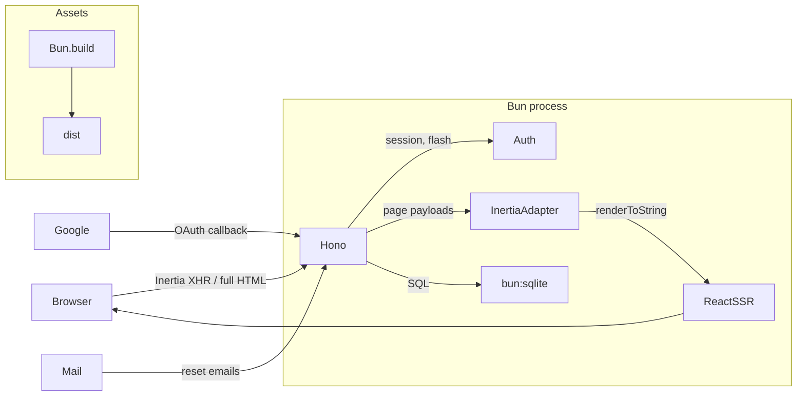

# Panceg

Sundanese for _firm_ or _steadfast_ — a solid full-stack foundation.

[](https://github.com/arghoritma/panceg/actions/workflows/ci.yml)
[](LICENSE)
[](https://bun.sh)

A production-shaped, full-stack boilerplate: **Hono** (HTTP) + **bun:sqlite**
(database) + **Inertia v3 / React 19** (server-driven UI with in-process SSR),
running entirely on **Bun**. Auth (register / login / logout / forgot-password /
Google OAuth), roles, rate limiting, tus uploads, migrations, tests, and Docker
are wired end to end.



## Philosophy

**Panceg** is Sundanese for _firm_ or _steadfast_. Every choice favors the
next maintainer — human or AI agent — over cleverness:

- **Minimal dependencies.** Tailwind CSS v4 (via `@tailwindcss/cli`, no
  PostCSS), a hand-rolled rate limiter and OAuth client instead of packages
  that pin the stack, raw `bun:sqlite` instead of an ORM. Dependencies are a
  liability; when a hand-rolled 60-line module does the job, it ships.
- **One obvious way to do things.** A single structural convention (codified
  in `AGENTS.md`): routes in `routes/<feature>.routes.ts` with handlers
  inline, database lifecycle in `src/db/`, prepared queries in
  `src/server/repo/`, and schema in versioned migrations. No feature folders,
  no second way to do the same thing.
- **Discoverability as a contract.** Given any URL you can derive the file
  that owns it: `src/server/routes/` mirrors URL namespaces, every URL lives
  in exactly one file (GET renders + POST actions together), and new
  features get their own `<feature>.routes.ts`. Tests run deterministically
  (`bun test --isolate`). The repo is built to be extended safely by anyone.
- **Production-shaped, not production.** The guardrails a deployed app needs
  — migrations, CSRF, rate limiting, security headers, session rotation,
  graceful shutdown, CI, Docker — are wired from day one, so you start with a
  skeleton that is _shaped_ like a production app. But it is not one: the
  only pre-built feature is auth, and anything deployment-specific
  (Redis-backed rate limiting for horizontal scaling, CDN, observability) is
  a deliberate swap point. The product is yours to add by following the
  conventions.
- **Boring versions, current versions.** Hono 4.x (stable, runtime-agnostic),
  Bun 1.4+. Upgrades are deliberate decisions, not defaults.
- **Correctness over cleverness.** Synchronous, explicitly typed,
  parameterized queries, fail-fast config, documented decisions (see
  "Notes / decisions" below). If a piece can't be explained in one sentence,
  it doesn't belong in a starter.

## Quick start

```bash
# Scaffold a new project (prompts for template, installs deps, creates .env)
bun create panceg@latest my-app
cd my-app
bun run dev          # http://localhost:4000

# Or pick a template directly:
bun create panceg@latest my-app --template react-tailwind
```

### Templates

| Template          | Stack                      | Branch                     |
| ----------------- | -------------------------- | -------------------------- |
| `default`         | Svelte 5 + Tailwind CSS v4 | `main`                     |
| `svelte-tailwind` | Svelte 5 + Tailwind CSS v4 | `template/svelte-tailwind` |
| `react-tailwind`  | React 19 + Tailwind CSS v4 | `template/react-tailwind`  |

This branch uses React 19 with Tailwind CSS v4 (via `@tailwindcss/cli`, no
PostCSS). The other templates provide equivalent stack variants with the same
auth, roles, SSR, and test suite.

### Scripts

| Command             | What it does                                                     |
| ------------------- | ---------------------------------------------------------------- |
| `bun run dev`       | Watch mode; rebuilds client assets on restart                    |
| `bun run dev:api`   | Standalone API server in watch mode (port `API_PORT`)            |
| `bun run build`     | Prebuild client assets → `dist/` (+ `manifest.json`)             |
| `bun run start`     | Serve prebuilt assets (`NODE_ENV=production`)                    |
| `bun run start:api` | Standalone API server (`NODE_ENV=production`)                    |
| `bun run test`      | E2E suite (auth, roles, reset flow, Inertia, tus, avatar upload) |
| `bun run db:seed`   | Create a demo user (`[email] [password] [role]` args)            |
| `bun run typecheck` | TypeScript diagnostics via `tsc --noEmit`                        |
| `bun run lint`      | Biome lint for `src`, `tests`, and `scripts`                     |

## Features

- **Auth**: register, login, logout — argon2id passwords, DB-backed sessions
  (httpOnly `SameSite=Lax` cookies, 30-day expiry), CSRF (Origin check).
- **Forgot / reset password** with email delivery (see Mail below) and
  hashed reset tokens (60-minute expiry).
- **Google OAuth** register-or-login (zero-dep, plain fetch; button hidden
  when not configured). The profile picture is downloaded and stored locally
  (the CSP blocks external images), so avatars always load from our origin.
- **Roles**: `user` / `admin`, `requireRole('admin')` guard, `/admin` page
  with paginated user list.
- **Standalone API server**: a second, JSON-only Hono process on its own port
  (`API_PORT`, default 4001) sharing the same database, authenticated with
  personal bearer tokens generated, expired, and revoked from the dashboard
  (`/tokens`). Raw tokens are shown once; only their SHA-256 hash is stored.
- **Rate limiting**: global per-IP limit on all routes (DDoS baseline, excludes `/health` and `/assets/*`) plus a stricter layer on auth endpoints (brute-force protection). In-memory fixed window, configurable via env.
- **Inertia v3**: full SSR on first load, SPA navigation after, asset-version
  negotiation (409 + reload), partial reloads, flash messages, shared props.
- **Two upload protocols**:
  - **Regular upload** (multipart/form-data) for files ≤ 100 MB. Avatar
    uploads use this path: the image is decoded, resized to 256×256 and
    re-encoded to WebP with `Bun.Image` (Bun 1.4) before storage, so
    avatars are always small, raster, and served from our own origin.
  - **tus protocol v1** at `/uploads` (creation, creation-with-upload,
    termination, expiration, checksum) with SQLite state and on-disk
    storage — for resumable chunked uploads of files > 100 MB where a
    plain multipart request would be unreliable.
- **Migrations**: versioned SQL files applied at startup in transactions.
- **Ops**: batched request logging with correlation id, gzip compression,
  security headers (CSP, nosniff, frame denial), `/health`, graceful
  shutdown, Docker.
- **Testing**: `bun test` — boots the app against an in-memory SQLite DB.

## Configuration (.env)

| Variable                                             | Default                 | Notes                                                                                      |
| ---------------------------------------------------- | ----------------------- | ------------------------------------------------------------------------------------------ |
| `PORT`                                               | `4000`                  | In dev, auto-increments to the next free port if busy (prod fails fast)                    |
| `API_PORT`                                           | `4001`                  | Standalone API server (`bun run dev:api` / `start:api`) — same database, bearer-token auth |
| `APP_URL`                                            | `http://localhost:4000` | Absolute base URL (email links, OAuth redirects)                                           |
| `DATABASE_PATH`                                      | `./data/app.sqlite`     |                                                                                            |
| `SSR`                                                | `true`                  | `false` ships an empty shell — client renders from scratch (no hydrate)                    |
| `MAIL_DRIVER`                                        | `log`                   | `log` \| `resend` \| `mailtrap`                                                            |
| `MAIL_FROM`                                          | `no-reply@example.com`  |                                                                                            |
| `RESEND_API_KEY`                                     | —                       | required when `MAIL_DRIVER=resend`                                                         |
| `MAILTRAP_API_TOKEN`                                 | —                       | required when `MAIL_DRIVER=mailtrap`                                                       |
| `MAILTRAP_INBOX_ID`                                  | —                       | use the sandbox endpoint when set                                                          |
| `GOOGLE_CLIENT_ID` / `GOOGLE_CLIENT_SECRET`          | —                       | enable Google OAuth (both or none)                                                         |
| `RATE_LIMIT_GLOBAL_MAX` / `RATE_LIMIT_GLOBAL_WINDOW` | `200` / `60`            | per-IP requests per window on all routes (excludes `/health`, `/assets/*`)                 |
| `RATE_LIMIT_AUTH_MAX` / `RATE_LIMIT_AUTH_WINDOW`     | `30` / `60`             | stricter per-IP limit on auth endpoints (brute-force protection)                           |
| `UPLOAD_DIR`                                         | `./data/uploads`        | tus upload bytes on disk                                                                   |
| `TUS_MAX_SIZE`                                       | `0`                     | max upload size in bytes (`0` = unlimited)                                                 |
| `TUS_EXPIRATION_SECONDS`                             | `0`                     | unfinished upload TTL in seconds (`0` = no expiry)                                         |
| `METRICS_TOKEN`                                      | —                       | bearer token for `/metrics`; if unset, `/metrics` is restricted to loopback only           |

Invalid/incomplete config fails fast at startup with a clear message
(`src/server/configs/index.ts`).

### Google OAuth setup

1. [Google Cloud Console](https://console.cloud.google.com/apis/credentials) →
   create OAuth client (Web application).
2. Authorized redirect URI: `https://<your-domain>/auth/google/callback`
   (`http://localhost:4000/auth/google/callback` for local dev).
3. Set `GOOGLE_CLIENT_ID` and `GOOGLE_CLIENT_SECRET` in `.env`.

### Mail drivers

- **log** (default): prints a formatted message and records it in
  `sentMails` — usable in dev and asserted in tests.
- **resend**: set `RESEND_API_KEY` (`MAIL_DRIVER=resend`).
- **mailtrap**: set `MAILTRAP_API_TOKEN` (`MAIL_DRIVER=mailtrap`); add
  `MAILTRAP_INBOX_ID` to use the sandbox endpoint.

### Standalone API server

A separate, JSON-only Hono process (`src/api.ts`) listens on `API_PORT`
(default 4001) against the **same database** as the web server:

```bash
bun run dev:api     # watch mode → http://localhost:4001
bun run start:api   # production
```

- `GET /health` — public liveness probe.
- `GET /v1/me` — example authenticated route; every `/v1/*` route requires
  `Authorization: Bearer <token>`. Unknown/invalid/expired/revoked tokens get
  `401` with `WWW-Authenticate: Bearer`.

Tokens are managed from the dashboard at **`/tokens`**: create a named token
with an optional expiration (7–365 days or never), copy the raw value once
(it is only shown at creation), and revoke it at any time — revocation takes
effect on the next request. The database stores only a SHA-256 hash, so a
database leak cannot expose usable tokens. Add new API routes in
`src/server/routes/apis/v1.routes.ts`.

## Architecture

AI agents: follow [`AGENTS.md`](AGENTS.md) — it codifies the layout rules
below so new code stays structurally consistent.

```
src/
├── index.ts                # entry: build assets (dev), Bun.serve, graceful shutdown
├── api.ts                  # standalone API server entry (API_PORT, bearer-token auth)
├── db/
│   ├── index.ts            # SQLite connection, pragmas, startup migration bootstrap
│   ├── migrations.ts       # migration runner and generated ERD support
│   └── migrations/         # versioned SQL schema files (0001, 0002, …)
├── server/
│   ├── app.ts              # web composition: middleware, error handlers, routes
│   ├── api.ts              # JSON-only API composition (no Inertia/SSR/assets)
│   ├── configs/index.ts    # validated environment configuration
│   ├── middlewares/        # cache, compression, Inertia context, rate limit, security
│   ├── platform/           # Inertia adapter, metrics, SSR helpers
│   ├── repo/               # prepared, parameterized SQL statements grouped by domain
│   ├── services/           # auth, mail, assets, uploads, logging
│   ├── utils/validation.ts # TypeBox JSON validation → ValidationFailed (422)
│   └── routes/
│       ├── api.routes.ts          # /api/session (identity for public pages)
│       ├── auth.routes.ts         # /login /register /logout /forgot/reset (GET+POST)
│       ├── google-oauth.routes.ts # /auth/google, /auth/google/callback
│       ├── pages.routes.ts        # app-shell pages: /, /dashboard, /admin
│       ├── profile.routes.ts      # /profile page + /profile/avatar (multipart + Bun.Image)
│       ├── tokens.routes.ts       # /tokens page: create/revoke API bearer tokens
│       ├── uploads.routes.ts      # /uploads* (tus resumable upload)
│       └── apis/v1.routes.ts      # /v1* (standalone API server, bearer-token auth)
├── client/
│   ├── app.tsx             # Inertia client bootstrap (hydrate or mount)
│   ├── ssr.tsx             # in-process SSR renderer (react-dom/server)
│   ├── pages.ts            # explicit page registry (shared by SSR + bundle)
│   ├── pages/              # Login, Register, Dashboard, ForgotPassword,
│   │                       # ResetPassword, Admin, NotFound (.tsx)
│   ├── components/         # Layout, AuthLayout, Brand, Field (.tsx)
│   ├── tailwind.css        # @import tailwindcss + @theme inline (token bridge)
│   └── styles.css          # design-token CSS variables + @keyframes only
├── shared/
│   ├── types.ts            # User, Role, FlashData, SharedPageProps, Paginated
│   └── inertia.d.ts        # InertiaConfig augmentation → typed props.auth
├── tests/                  # bun:test E2E suite (in-memory DB)
└── scripts/                # build, migration, seed, and dev lifecycle entry points
```

## How the pieces fit

- **Request lifecycle**: `requestLogger` (correlation id) → `checkOrigin`
  (CSRF) → `secureHeaders` → inertia session resolve → global rate limit →
  guards + handler → Inertia render (SSR HTML for browsers, JSON for
  `X-Inertia` XHR) → `onError` (422 validation with friendly field
  messages, 500) / `notFound` (404 Inertia page).
- **Auth**: argon2id via `Bun.password`; 256-bit random session tokens in
  SQLite; cookies httpOnly/`SameSite=Lax`/Secure-in-prod. Logout deletes the
  session row server-side. `passwordHash` never leaves the server.
- **Guards** are Hono middleware: `requireAuth`, `guestOnly`,
  `requireRole('admin')` (non-admins redirect to `/dashboard`). They return a
  Response to short-circuit the chain, or call `next()`.
- **Rate limiting** is an in-memory fixed-window limiter keyed by
  `X-Forwarded-For`/peer IP (Bun's `server.requestIP` via `c.env`). Two
  layers: a global limiter in `app.ts` (DDoS baseline, excludes `/health`
  and `/assets/*`) and a stricter one on auth routes (brute-force). Swap
  the store for Redis behind the same hook signature when scaling
  horizontally.
- **Inertia v3 protocol** (`platform/inertia.ts`): full HTML with SSR markup +
  `data-page` JSON for browser visits; JSON page payloads for XHR;
  `409 + X-Inertia-Location` on asset-version mismatch; partial reloads via
  `X-Inertia-Partial-*`; one-shot flash and shared props merged per page.
- **SSR + hydration**: `renderPage()` renders with
  `createInertiaApp({ page, render: renderToString })`; the client hydrates
  when `data-server-rendered` is present. Same page registry on both sides.
- **Asset versioning**: `Bun.build` emits content-hashed files; the hash is
  the Inertia `version`. Stale clients get a 409 and reload.
- **Validation**: TypeBox schemas at the route level (see
  `src/server/utils/validation.ts`); `onError` maps `ValidationFailed` to 422
  Inertia page payloads (`VALIDATION_MESSAGES` in
  `routes/auth.routes.ts`). The `email` format is registered explicitly —
  plain `@sinclair/typebox` does not pre-register string formats.

## Database migrations

Schema changes are plain SQL files in `src/db/migrations/`, applied in filename order
inside a transaction and recorded in `schema_migrations`. New migrations use
one reversible `<version>_<name>.sql` file with `-- up` and `-- down` sections.
The runner stores an SHA-256 checksum for each applied migration and refuses to
continue if migration history was edited.

```bash
# creates the next numbered migration, for example src/db/migrations/0008_add_last_login.sql
bun run db:make add_last_login

# development default: pending migrations run at server startup
bun run dev

# controlled release mode: apply, inspect, or roll back one latest migration
bun run db:migrate
bun run db:status
bun run db:rollback
```

The migration CLI regenerates `erd.dbml` from the resulting SQLite schema after
every successful `db:migrate` or `db:rollback`. Treat it as a generated schema
diagram: do not edit it manually, and commit its update with the migration.
Server startup migrations intentionally do not write this repository file.

The generator creates this editable template. Marker lines must remain exactly
`-- up` and `-- down`; use `--` for any additional SQL comments.

```sql
-- 0008_add_last_login

-- up
ALTER TABLE users ADD COLUMN last_login_at TEXT;

-- down
ALTER TABLE users DROP COLUMN last_login_at;
```

Development workflow:

1. Generate a lowercase `snake_case` migration with `bun run db:make <name>`.
2. Write the forward schema change under `-- up` and its exact inverse under
   `-- down`.
3. Start the app with `MIGRATIONS_MODE=startup` or run `bun run db:migrate` to
   apply it locally.
4. Confirm its state with `bun run db:status`; run `bun run db:rollback` before
   committing when testing the reverse operation.
5. Commit the migration with the code that depends on the schema. Never rewrite
   it after it has been applied outside a disposable local database.

Rules:

- **Never edit an applied migration** — add a new numbered file instead.
- Write the exact reverse operation below the `-- down` marker. Rollback
  operates on one latest migration only, inside a transaction.
- Existing single-file `.sql` migrations without `-- up`/`-- down` markers
  remain supported as up-only history; they cannot be rolled back automatically.
- `MIGRATIONS_MODE=startup` is the development default. Set
  `MIGRATIONS_MODE=cli` to prevent app startup from mutating schema; the
  deployment release script uses this mode and runs `bun run db:migrate`
  before restart.
- SQLite `ALTER TABLE ADD COLUMN` with `NOT NULL` requires a `DEFAULT`.
- A failed migration rolls back and aborts startup.
- `db:rollback` only reverses the latest applied migration. It refuses legacy
  up-only files and does not support rolling back a migration in the middle of
  history.
- `createMigration()` belongs to `src/db/migrations.ts`; the
  `scripts/create-migration.ts` entry point only parses CLI arguments and calls
  it. Keep migration behavior in the server module rather than duplicating it
  in scripts.
- To rebuild a disposable development database, delete `data/app.sqlite*` and
  restart. Never use this approach for production data.

## Testing

```bash
bun test --isolate   # or: bun run test
```

The suite boots the full app against an in-memory SQLite database
and drives it through `app.request()`: registration/login/logout, guards and
roles, password reset end to end (via the log mail driver), Inertia protocol
(409/404/SSR), CSRF, `/health`, static asset serving, the tus
resumable-upload flow (creation, resume, checksum, termination, ownership),
and avatar upload via multipart with Bun.Image re-encoding to WebP.

`--isolate` gives each test file fresh globals. It is required: the files
are written as independent suites — each sets its env (`DATABASE_PATH`,
`UPLOAD_DIR`, …) in `beforeAll` before importing the app, and `db.close()`s
in `afterAll` — so running them in one shared process would let one file's
teardown finalize the next file's prepared statements.

## Deployment

```bash
docker compose up -d --build
```

- Multi-stage `Dockerfile` (`oven/bun:1.4-alpine`): assets prebuilt in the
  build stage, production deps only at runtime. The app process runs as a
  non-root user (`bun`, UID 1000) — the entrypoint fixes the `./data`
  bind-mount ownership, then drops privileges before exec'ing Bun.
- `./data` volume keeps the SQLite database across restarts; healthcheck hits
  `/health`.

Alternatives: `bun build --compile` for a single binary, or plain
`bun run start` behind your process supervisor (it handles SIGTERM
gracefully).

For a non-Docker single-host deployment behind Caddy, use the versioned
[`deploy/`](deploy/README.md) bundle. It provides a hardened systemd unit,
production environment template, Caddy reverse-proxy configuration, host
bootstrap, and release health check.

## Styling

**Tailwind CSS v4** — prefer utility classes directly in React components
(`class="flex items-center gap-2 …"`). Existing components also have
co-located CSS files; preserve that established pattern when modifying them.
Design tokens (colors, radius, shadow) are defined as CSS variables in
`src/client/styles.css` and bridged to Tailwind theme tokens via
`@theme inline` in `src/client/tailwind.css`, so utilities like
`bg-surface`, `text-primary`, and `border-border` auto-switch on dark mode
via `var()` resolution — no duplicated values.

Dark mode uses `[data-theme="dark"]` on `<html>` (set by an inline head
script to avoid FOUC). The `dark:` variant maps to this attribute, so
one-off dark overrides use `dark:bg-green-950 dark:text-green-300`.

`src/client/styles.css` holds **only** design-token CSS variables and
`@keyframes` — no component CSS. The Tailwind CLI (`@tailwindcss/cli`) runs as a pre-build step
in `src/server/services/assets.ts` (no PostCSS), outputting `src/client/.tailwind.css`
which is imported before `styles.css` in `app.ts`.

## Notes / decisions

- **Bun 1.4+ required** — avatar upload uses `Bun.Image` (decode, resize,
  re-encode to WebP), which is only available in Bun 1.4+. The `bun`
  engine constraint in `package.json` enforces this.

- **Hono integration gotchas handled**: Hono converts HEAD requests to GET
  (body stripped, headers kept) while `c.req.method` still reports "HEAD" —
  the tus `dispatch` uses that to route HEAD correctly; `c.header()`-queued
  headers (cookies!) are dropped when a handler returns a custom `Response`,
  so cookie helpers append to `c.res.headers` directly; the `/*` wildcard
  produces no named param, so upload ids are derived from `c.req.path`;
  `hono/conninfo`'s ESM build is an empty stub in 4.13, so the rate limiter
  reads the peer IP from `c.env` (the Bun server) instead.
- `import.meta.glob` was removed from Bun 1.3 — the page registry uses
  explicit imports.
- In dev, `bun --watch` rebuilds client assets on every change, so the
  Inertia version changes; an already-open tab does one 409 + full page
  reload after a rebuild (version negotiation), then settles back to SPA
  navigation. Refresh after a server restart if you see a one-off reload.
- CSP uses per-request nonces for inline Inertia payload and theme scripts;
  `unsafe-inline` is not enabled.
- `X-Forwarded-For` is trusted for rate limiting — only run behind a proxy
  that sets it. In bare-metal production Bun binds to `127.0.0.1` by default;
  set `HOST=0.0.0.0` only when the listener must be reachable directly (the
  Docker Compose service does this explicitly).
- gzip compression is a custom middleware (`compress.ts`) — Hono's built-in
  relies on the Web `CompressionStream`, which is not reliably present in
  every Bun 1.3.14 context; `node:zlib` is. `busy_timeout = 5000` is set so
  concurrent writes wait instead of failing with SQLITE_BUSY.
- Prefer Svelte? `bun create panceg@latest my-app --template svelte-tailwind`.
  The server side is adapter-agnostic — Inertia v3 works with React, Svelte,
  or Vue. A verified Svelte 5 migration guide (Bun.build plugin, SSR, API
  mapping) is in the
  [Svelte 5 migration guide](.llm-wiki/wiki/concepts/svelte-5-migration.md).
